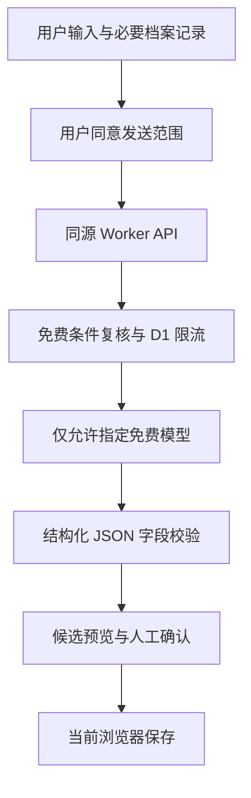

# 记得你

**记下重要之人的点滴，让送礼从了解开始。** 一个以私人喜好手记为基础的 AI 记录与送礼助手 MVP。

[在线体验](https://remember-you.25yqdu.workers.dev/) · [验收记录](docs/verification-2026-11-27.md) · [部署说明](CLOUDFLARE-DEPLOY.md)

> 首次进入人物列表为空。点击顶部「示例与备份」→「进入虚构示例体验」，无需建立真实档案即可体验；示例修改不写入本地正式资料。AI 页面可主动切换「体验演示」，这是规则 / 固定候选库，**不是真实 AI**。
>
> 真实 AI 的服务端适配已实现，生产环境已配置新 Secret：文字记录和送礼推荐实测均返回 HTTP 200；生产频率 / 并发拦截返回 HTTP 429。开发者已核对本次测试账单并确认扣费为 0；这是本次测试结果，不代表未来永久免费。模型能力及费用以实际服务商规则和调用账单为准。

## 为什么做这个产品

朋友随口说过的喜好、忌口和愿望容易散落在聊天与记忆中，临近生日时又从零开始挑礼物。项目尝试把「轻量记录 → 人物记忆 → 可解释的送礼方案」连接起来，降低记录成本和送礼决策成本。

这是个人 AI 产品经理求职作品：展示需求拆解、范围取舍、确认式 AI 交互、隐私边界、成本保护与交付验证；尚无经过验证的用户增长或商业指标。

## 核心功能

- **人物档案**：新增、编辑、二次确认删除，头像压缩与预览；允许不完整生日，按有效信息展示年龄与星座。
- **分类手记**：喜欢、不喜欢、明确禁忌、中性事实和愿望；分类可新增、改名、删除，已有记录必须先迁移；支持搜索筛选。
- **AI 帮我记**：自然语言拆分候选，保留用户编辑、取消选择和重复处理；确认后才入档。
- **送礼助手**：预算、场合和倾向，三种方向，说明偏好依据、估算预算和注意事项；支持收藏、取消收藏、已送记录。
- **备份恢复**：JSON 导出与导入；校验版本、关联和容量；冲突选择另存副本或跳过，保留原资料。
- **独立示例体验**：虚构人物与偏好，只在本次页面内编辑，退出或刷新即结束，不自动初始化普通档案。

## 产品设计取舍

1. **先可靠记录，再做智能建议**：人物和喜好在没有 AI 时仍可用。
2. **AI 建议，用户决定**：模型不直接改档案；不确定信息与重复项需要确认。
3. **解释推荐依据**：只允许引用实际 like / wish 记录 ID，不编造实时价格、库存或链接。
4. **限制推荐空间**：真实 AI 从受控候选库中选择并组织理由，便于检查禁忌和三种方向；因此无法承诺无限生成任意礼物。
5. **本地优先**：不做账号和云同步，减少早期复杂度；同时明确共享浏览器和清理数据的风险。
6. **费用优先于可用性**：免费条件变化、校验失败、复核到期时停用，不自动切收费模型。

## 实际页面

以下为本次本地浏览器验收截图，人物为虚构测试数据；不是生成的概念图，也不代表真实 AI 调用成功。


<details><summary>手机端首页（390px 外层视口）</summary>


</details>

## AI 工作流程



文字记录读取当前分类（包含自定义分类）；模型可建议分类，但不能静默创建。送礼只发送必要偏好、禁忌、愿望、已送记录、收藏名称及送礼条件，不发送姓名、头像或生日。输入文字属于不可信数据，不作为系统指令执行。

**截图识别尚未启用**：免费型号没有已验证的图片理解能力；本地预览不会向模型上传截图，不切换收费视觉模型。

## 技术架构

| 层 | 实现 |
| --- | --- |
| 界面 | React 19 + Vite 6，手机优先 CSS，保留轻蕾丝手账首页 |
| 人物数据 | localStorage，兼容 v1 → v2 迁移，压缩头像随备份保存 |
| API | Cloudflare Worker，与 Static Assets 同域 `/api/` |
| 模型 | 小力孩 AI 的 OpenAI 兼容 HTTP 接口，服务端 JSON 校验 |
| 限流 | Cloudflare D1 单张 `ai_quota` 表，短期哈希计数及并发租约 |
| 更新 | GitHub main → Cloudflare Workers Builds |

未引入账号系统、云端人物数据库、支付或商品商城。D1 不保存人物资料。

## 本地运行

建议 Node.js 24（测试使用 `node:sqlite`）。

```bash
npm ci
npm run dev
```

本地开发默认不启用真实 AI。Vite 本身没有 D1 绑定，因此真实请求会安全失败；不能靠填前端密钥绕过。规则演示可直接使用。

```bash
node --test src/backup.test.js server/limits.test.js server/free-policy.test.js server/cloudflare.test.js server/ai.test.js server/network.test.js
npm run build:cloudflare
```

`npm test` / `npm run test:v3` 保留原有测试入口。测试通过仅说明对应代码检查通过，不能替代真实服务商、生产 D1 和线上部署验收。

## Cloudflare 部署与配置

按 [Cloudflare 部署指南](CLOUDFLARE-DEPLOY.md)操作。使用已有数据库，**不要重复创建**。fork 后先把 `wrangler.jsonc` 的 D1 绑定改为自己的数据库 UUID；此 UUID 不是访问密钥。

| Workers Builds 设置 | 值 |
| --- | --- |
| 分支 / 根目录 | `main` / `/` |
| 构建命令 | `npm run build:cloudflare` |
| 部署命令 | `npm run deploy:cloudflare` |

部署脚本先应用现有幂等迁移，再部署 Worker 与静态资源。Wrangler CLI 固定版本，未新增应用依赖。构建配置与运行时 Secrets 是两个不同位置。

在 **Worker → Settings → Variables and Secrets** 配置：

| 配置 | 用途 |
| --- | --- |
| `AI_API_KEY`（Secret） | 新的、仅允许指定免费型号的专用密钥 |
| `AI_RATE_SALT`（Secret） | 随机长字符串，用于来源哈希 |
| `AI_ENABLED` | 默认 `false`，安全配置后才开启 |
| `AI_BASE_URL` | `https://www.ygxnhzy.cn/v1` |
| `AI_TEXT_MODEL` | `DeepSeek-V4.1-Flash 小力孩AI`，须重新核实目录 |
| `AI_FREE_ONLY` | `true` |
| `AI_FREE_KEY_RESTRICTED` | 仅在核实密钥唯一允许免费型号后设为 `true` |
| `AI_FREE_REVIEW_UNTIL` | 人工复核截止时间，ISO 格式，最多未来 24 小时 |

**复核不会自动续期**。到期即停止 AI 请求；即使在有效期内，每次请求仍检查服务商公开目录中的免费 / 可用 / 零价格状态和密钥模型列表。更新截止时间前必须再次核对费用条件，不应仅为演示盲目延长。

## 隐私、安全与费用边界

- 同一浏览器配置、同一域名的访问者共享本地资料；没有按登录账户隔离。不同设备、浏览器或域名不自动同步。
- 首次访问为空；旧版无法分辨真 / 示例的数据不自动删除。导出备份含私人信息，请自行保管。
- AI 请求经本站服务端发送第三方；第三方仍会处理文本，请勿输入身份证、联系方式和无关聊天。用户不需填写 Key。
- Key 只放服务端 Secret；不使用 `VITE_` 变量，不写 Git、日志或 ZIP。`.gitignore` 排除 `.env*` / `.dev.vars*` 等。
- 当前生产每 IP 每分钟 2 次（代码默认值为4）、每天 15 次，全站每天 50 次；同来源并发 1、全站并发 2。失败请求可能消耗站内次数。
- D1 保存限流窗口、用量、过期时间和每日加盐来源哈希，不保存原始 IP、档案、截图或提示词。多用户共用出口 IP 会共享限额，分布式滥用仍可能耗尽全站额度。
- 紧急关闭：Worker 设置中把 `AI_ENABLED` 改为 `false` 并部署。已开始的上游请求可能继续；必要时撤销专用 Key。
- Cloudflare 免费套餐和第三方免费活动均有限额，不承诺永久免费。查看 Cloudflare Metrics / D1 用量及小力孩账单；不得自动充值、激活付费额度池或切换付费模型。

## 当前限制与后续方向

- 真实文字 / 送礼 API 已成功，生产频率与并发拦截已实测；开发者已确认本次测试账单扣费为0；全站紧急开关的生产实操仍待完成，不把这几类验收混为一谈。
- 无云同步、账号权限或本地加密；重要资料依赖用户定期备份。
- 截图识别未实现，礼物候选库有限，禁忌文字排除无法替代过敏原 / 材质核实。
- 本次响应式验收为浏览器 iframe 的 390 / 768 / 1440px 视口，不等同于真实手机设备测试。
- 下一步应优先以少量真实场景评估记录确认成本、分类准确性和推荐有用性，再决定扩充候选库及存储架构。

原有实现和验收历史保留在 [开发记录](docs/development-notes.md)、[V3 历史验收](QA.md)、[V2 验收](QA-V2.md)、[免费配置说明](AI-FREE-SETUP.md)；其中日期性结论不能当作当前线上状态。
